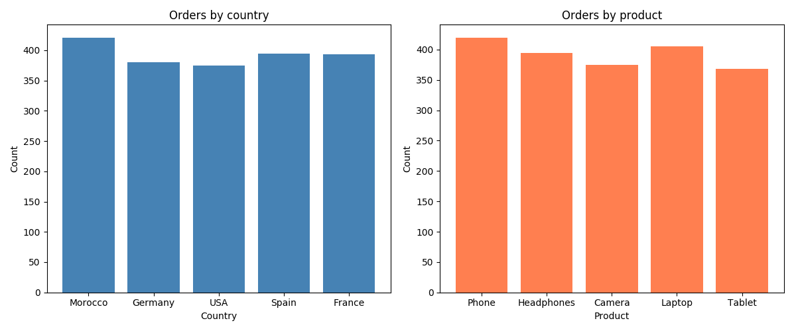

# 🛒 Real-Time E-Commerce Analytics Pipeline

A Big Data pipeline that processes e-commerce orders in real-time using **Apache Kafka**, **Apache Spark Streaming**, and **HDFS** — built on a Cloudera QuickStart VM.

---

## 📊 Output Visualization



*Real-time aggregation of 1963 orders — distributed across 5 countries and 5 product categories*

---

## 🏗️ Architecture

```
┌─────────────────┐     ┌─────────────────┐     ┌──────────────────┐     ┌─────────────────┐
│   Python        │     │   Apache        │     │  Spark           │     │    HDFS         │
│   Producer      │────▶│   Kafka         │────▶│  Streaming       │────▶│  Storage        │
│                 │     │   Broker        │     │  Consumer        │     │                 │
│ Generates       │     │                 │     │                  │     │ /ecommerce/     │
│ fake orders     │     │ Topic:          │     │ 5-sec micro-     │     │ orders/         │
│ every second    │     │ ecommerce-      │     │ batches          │     │ (partitioned    │
│                 │     │ orders          │     │                  │     │  by timestamp)  │
└─────────────────┘     └─────────────────┘     └──────────────────┘     └────────┬────────┘
                                                                                   │
                                                                                   ▼
                                                                        ┌─────────────────┐
                                                                        │  Matplotlib     │
                                                                        │  Visualization  │
                                                                        │                 │
                                                                        │ Bar charts:     │
                                                                        │ - By country    │
                                                                        │ - By product    │
                                                                        └─────────────────┘
```

---

## 🔧 Tech Stack

| Component | Technology | Version |
|-----------|-----------|---------|
| Message Broker | Apache Kafka | 0.10.2.2 |
| Stream Processing | Apache Spark Streaming | 1.6.0-cdh5.13 |
| Distributed Storage | HDFS (Hadoop) | 2.6.0-cdh5.13 |
| Producer / Visualizer | Python | 2.7.18 |
| Platform | Cloudera QuickStart VM | CDH 5.13 |
| Coordination | Apache ZooKeeper | 3.4.5 |
| Visualization | Matplotlib | 2.2.5 |

---

## 📁 Project Structure

```
ecommerce-realtime-pipeline/
│
├── producer.py           # Kafka producer — simulates e-commerce orders
├── consumer_spark.py     # Spark Streaming consumer — reads Kafka, writes to HDFS
├── visualize.py          # Reads HDFS, generates bar chart visualizations
├── ecommerce_stats.png   # Sample output: orders by country & product
└── README.md
```

---

## 📦 Data Schema

Each order message published to Kafka:

```json
{
  "order_id": 4821,
  "product": "Laptop",
  "price": 999.99,
  "country": "Morocco",
  "status": "completed"
}
```

**Products:** Laptop, Phone, Tablet, Headphones, Camera  
**Countries:** Morocco, France, Spain, Germany, USA  
**Statuses:** completed, pending, cancelled

---

## 🚀 How to Run

### Prerequisites
- Cloudera QuickStart VM (CDH 5.13)
- Kafka installed at `~/kafka/`
- Python 2.7 with `kafka-python` and `matplotlib`

### 1. Start ZooKeeper & Kafka
```bash
~/kafka/bin/zookeeper-server-start.sh ~/kafka/config/zookeeper.properties &
~/kafka/bin/kafka-server-start.sh ~/kafka/config/server.properties &
```

### 2. Create the Kafka topic
```bash
~/kafka/bin/kafka-topics.sh --create \
  --zookeeper localhost:2181 \
  --replication-factor 1 \
  --partitions 1 \
  --topic ecommerce-orders
```

### 3. Start the Spark Streaming consumer
```bash
spark-submit \
  --jars /home/cloudera/kafka/libs/spark-streaming-kafka_2.10-1.6.0-cdh5.13.0.jar,\
/home/cloudera/kafka/libs/kafka_2.11-0.10.2.2.jar \
  consumer_spark.py
```

### 4. Start the producer (in a new terminal)
```bash
python2.7 producer.py
```

### 5. Generate visualizations (after collecting data)
```bash
python2.7 visualize.py
```

The chart is saved as `ecommerce_stats.png`.

---

## 📈 Results

After running the pipeline for ~30 minutes:
- **1963 orders** processed and stored in HDFS
- **150+ HDFS batches** (5-second micro-batches)
- Uniform distribution across all countries and products (simulated data)

---

## 💡 Key Concepts Demonstrated

- **Lambda Architecture** — batch layer (HDFS) + speed layer (Spark Streaming)
- **Pub/Sub messaging** — decoupled producer and consumer via Kafka topics
- **Fault-tolerant streaming** — Spark checkpointing and Kafka offset management
- **Distributed storage** — HDFS partitioned by timestamp for efficient querying

---

## 👩‍💻 Author

**Najat Oudaoud Ouhmou**  
Engineering Student — SDBDIA (Data Science, Big Data & AI)  
ENSIASD Taroudant, Morocco

[](https://github.com/najato8)
